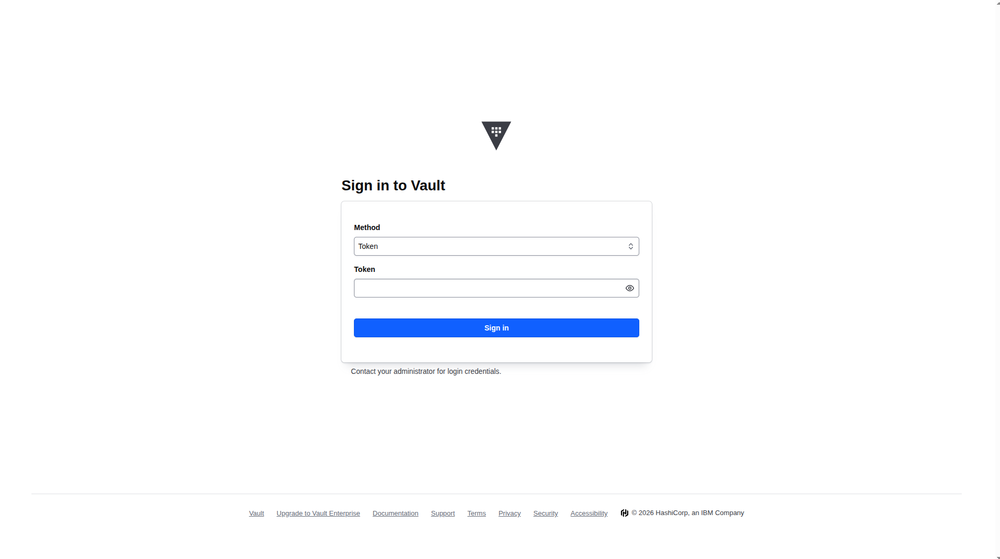
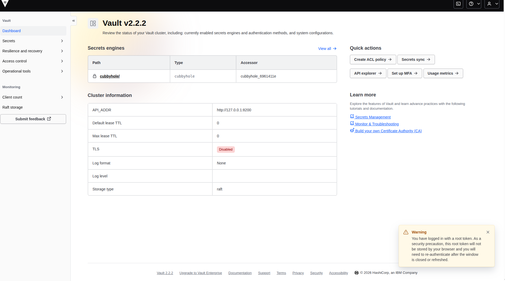

# Description
Deploy Vault Server with Docker and install Vault CLI in your host to test your Server.

## Steps
- **STEP-01**: Deploy Vault Server
```shell
$ docker compose up -d
```

- **STEP-02**: Initialize Vault Sever
Generate and save the **Unseal Keys** and the **Root Token**. In this case we will generate 3 unseal keys and only we need 2 of them to seal our Vault Server.\ 
You must seal your server always you start up to use the Root token to authenticate and use any Vault path(endpoints)
```shell
$ docker exec -it vault-server vault operator init -key-shares=3 -key-threshold=2
Unseal Key 1: dqI9ErhXhEALkICiWwvI6TJlgHpRzrK19ni2iLZAMD2J
Unseal Key 2: /v6UNIpEvvSTeXx7vN0Np7Vjac+zT42A1tfuX4AcqQ9q
Unseal Key 3: lJKKNXPJcI2XxJF065DN7p2+1B7aun0MChQUuu9wBfar

Initial Root Token: hvs.MAUzpJ55IRTzkv7oFex7SX5N

Vault initialized with 3 key shares and a key threshold of 2. Please securely
distribute the key shares printed above. When the Vault is re-sealed,
restarted, or stopped, you must supply at least 2 of these keys to unseal it
before it can start servicing requests.

Vault does not store the generated root key. Without at least 2 keys to
reconstruct the root key, Vault will remain permanently sealed!

It is possible to generate new unseal keys, provided you have a quorum of
existing unseal keys shares. See "vault operator rekey" for more information.
```

- **STEP-03**: Seal Vault Server
After create the Unseal Keys you must seal the server executing 2 times this command and introduce 2 of the three unseal keys created before
```shell
$ docker exec -it vault-server vault operator unseal
Unseal Key (will be hidden): 
Key                     Value
---                     -----
Seal Type               shamir
Initialized             true
Sealed                  true
Total Shares            3
Threshold               2
Unseal Progress         1/2
Unseal Nonce            2a26b820-aae0-91a2-0e26-9adcd3388d47
Version                 2.2.2
Build Date              2026-11-11T13:53:02Z
Storage Type            raft
Removed From Cluster    false
HA Enabled              true

$ docker exec -it vault-server vault operator unseal
Unseal Key (will be hidden): 
Key                     Value
---                     -----
Seal Type               shamir
Initialized             true
Sealed                  false
Total Shares            3
Threshold               2
Version                 2.2.2
Build Date              2026-11-11T13:53:02Z
Storage Type            raft
Cluster Name            vault-cluster-7723bac5
Cluster ID              f0dab97d-1fba-6837-b9c4-cd90663fa784
Removed From Cluster    false
HA Enabled              true
HA Cluster              n/a
HA Mode                 standby
Active Node Address     <none>
Raft Committed Index    33
Raft Applied Index      33
```

- **STEP-04**: Install Vault CLI
Now with Vault sealed, we can install the Vault CLI to interact with the Server. Install certificates and final Vault CLI. This is for Ubuntu Focal (20.04)
```shell
$ wget -O - https://apt- **STEP-04**: Install Vault CLI.releases.hashicorp.com/gpg | sudo gpg --dearmor -o /usr/share/keyrings/hashicorp-archive-keyring.gpg
$ echo "deb [arch=$(dpkg --print-architecture) signed-by=/usr/share/keyrings/hashicorp-archive-keyring.gpg] https://apt.releases.hashicorp.com jammy main" | sudo tee /etc/apt/sources.list.d/hashicorp.list
$ sudo apt update && sudo apt install vault
```

- **STEP-05**: Login Vault Server
Using your Root Token Login in Server. We can use `-address` all the time or export `VAULT_ADDR` to define the Vault Server host:
```shell
$ vault login -address=http://localhost:8200
Token (will be hidden): 
Success! You are now authenticated. The token information displayed below
is already stored in the token helper. You do NOT need to run "vault login"
again. Future Vault requests will automatically use this token.

Key                  Value
---                  -----
token                hvs.MAUzpJ55IRTzkv7oFex7SX5N
token_accessor       wCrnEku2amuieUsgv8NwMm5E
token_duration       ∞
token_renewable      false
token_policies       ["root"]
identity_policies    []
policies             ["root"]
```

We can use this environment variable:
```shell
$ export VAULT_ADDR='http://127.0.0.1:8200'
```

- **STEP-06**: Login using the Vault UI
We can use the UI to interact with the server too.
```shell
http://localhost:8200
```

Vault Login


Vault Portal


- **STEP-07**: Enable the KV v2 secrets engine from your host:
```shell
$ vault secrets enable -path=secret kv-v2
Success! Enabled the kv-v2 secrets engine at: secret/
```

-- **STEP-07**: Some test
Checj Vault Server status

```shell
$ vault status
Key                     Value
---                     -----
Seal Type               shamir
Initialized             true
Sealed                  false
Total Shares            3
Threshold               2
Version                 2.2.2
Build Date              2026-11-11T13:53:02Z
Storage Type            raft
Cluster Name            vault-cluster-7723bac5
Cluster ID              f0dab97d-1fba-6837-b9c4-cd90663fa784
Removed From Cluster    false
HA Enabled              true
HA Cluster              https://127.0.0.1:8201
HA Mode                 active
Active Since            2026-11-19T09:49:05.153572356Z
Raft Committed Index    243
Raft Applied Index      243
```

List all secret engines deployed in Vault Server

```shell
$ vault secrets list -detailed
Path               Plugin            Accessor                   Default TTL    Max TTL    Force No Cache    Replication    Seal Wrap    External Entropy Access    Options           Description                                                UUID                                    Version    Running Version         Running SHA256    Deprecation Status
----               ------            --------                   -----------    -------    --------------    -----------    ---------    -----------------------    -------           -----------                                                ----                                    -------    ---------------         --------------    ------------------
agent-registry/    agent_registry    agent-registry_6c1fd795    system         system     false             replicated     false        false                      map[]             agent registry                                             777c3fae-b826-3c99-4919-a7f002fc7711    n/a        v2.2.2+builtin.vault    n/a               n/a
cubbyhole/         cubbyhole         cubbyhole_6961411e         n/a            n/a        false             local          false        false                      map[]             per-token private secret storage                           5a248667-32a2-6b92-fc9e-5dc086255631    n/a        v2.2.2+builtin.vault    n/a               n/a
identity/          identity          identity_61a810ef          system         system     false             replicated     false        false                      map[]             identity store                                             ce45067c-f86a-c19e-e53d-343f4f51d6b1    n/a        v2.2.2+builtin.vault    n/a               n/a
secret/            kv                kv_5b4dc6d1                system         system     false             replicated     false        false                      map[version:2]    n/a                                                        8e735a05-9302-280b-9b5c-85107a9f5b0a    n/a        v0.27.0+builtin         n/a               supported
sys/               system            system_1bf7224b            n/a            n/a        false             replicated     true         false                      map[]             system endpoints used for control, policy and debugging    aedc74de-7078-faed-efba-0b4120a41f91    n/a        v2.2.2+builtin.vault    n/a               n/a
```

- **STEP-08**: use KV secret engine and make some tests
Test storing and reading a secret:
```shell
$ vault kv put secret/mi-app db_pass="supersecreto123"
vault kv put secret/mi-app db_pass="supersecreto123"
=== Secret Path ===
secret/data/mi-app

======= Metadata =======
Key                Value
---                -----
created_time       2026-11-19T10:10:00.779174113Z
custom_metadata    <nil>
deletion_time      n/a
destroyed          false
version            1

$ vault kv get secret/mi-app
vault kv get secret/mi-app
=== Secret Path ===
secret/data/mi-app

======= Metadata =======
Key                Value
---                -----
created_time       2026-11-19T10:10:00.779174113Z
custom_metadata    <nil>
deletion_time      n/a
destroyed          false
version            1

===== Data =====
Key        Value
---        -----
db_pass    supersecreto123
```

## Links
- [Vault CLI Installation](https://apt.releases.hashicorp.com/)
