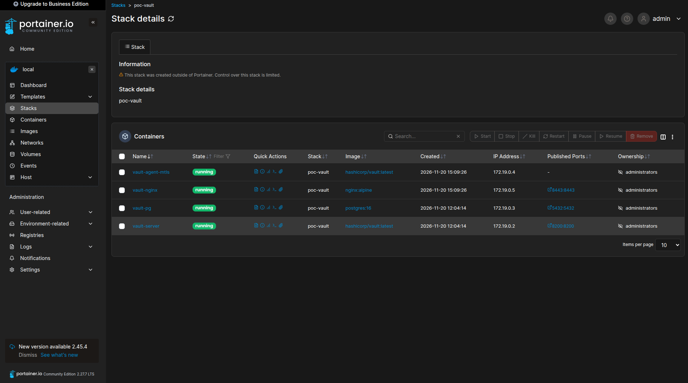

# Description
Deploy a Vault Server and several Vault user cases using Vault Agents and Docker containers.

## Deploy Vault Server

- [Vault Server](./services/vault-server/README.md)

## Deploy Vault Samples

- [Vault Simple Sample](./services/vault-agent/kv/README.md): A KV Secret Vault Sample using KV Secret Engine to be pulled by Vault Agent at frecuency.
- [Vault Database Sample](./services/vault-agent/database/README.md): A Password Secret PostgreSQL Database Vault Sample using Database Secret Engine to be rotated and pulled by a Vault Agent at frecuency.
- [Vault mTLS Sample](./services/vault-agent/mtls/README.md): A mTLS Vault sample using a PKI Secret Engine to generate temporal dynamic certificates pulled by Vault Agent to configure mTLS Nginx Web Server to be used by curl tool.

